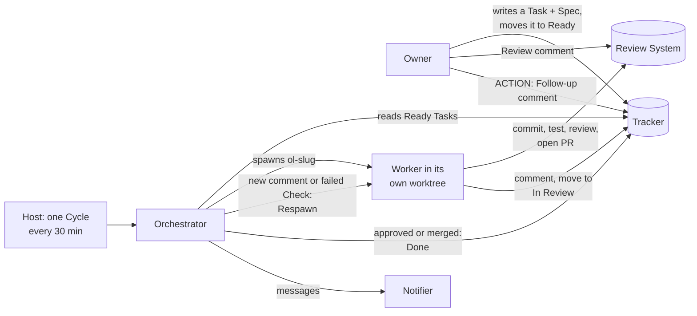

# Open Loops

Close your open loops while you sleep: specs in, reviewed PRs out.

> **Status: preview (v0.1).** Open Loops runs coding agents unattended, with your logins. Run it only in a trusted environment: a machine or account that holds only what Open Loops needs. Read [Safety](#safety) first.

Open Loops takes well-defined Tasks from your Tracker, gives each one to a coding-agent Worker in its own git worktree, and moves the result through review and feedback until the Task is Done. You bring your own tools for each part. A plain-language Contract says what each part must do.

<!-- Demo video: Task in Ready -> Worker in a worktree -> PR -> Review comment -> Respawn -> Done. -->

## Quick start

1. Tell your coding agent (Claude Code, Codex, or any agent with a shell):

   ```text
   Set up Open Loops from https://github.com/anubhavshrimal/open-loops
   ```

2. The agent follows [`SETUP.md`](SETUP.md). It checks your machine first, then asks one question at a time, each with a recommended default: a tool for each Slot, your project (repo path, build and test command), and the optional modules. It writes five notes files into `~/.openloops/`, installs the third-party skills from their source, and starts the Host.
3. **Verify.** The agent puts the sample Task [`examples/tasks/hello-file.md`](examples/tasks/hello-file.md) in Ready. The next Cycle (default: every 30 minutes) spawns a Worker. It adds `hello.txt` on the branch `ol-hello-file`, opens a PR, and moves the Task to In Review. Watch `~/.openloops/orchestrator.log` and the Notifier for `spawned`, then `in_review`.

No accounts? Say "use the local fallbacks" to the agent. Then a Markdown folder is the Tracker, a local branch is the PR, and a log file is the Notifier. Step by step: [`docs/quickstart.md`](docs/quickstart.md).

## How it works



1. **You write a Task** with a Spec (a Build Spec with acceptance criteria, or an Exploration Spec with a hypothesis) and move it to Ready.
2. **The Host starts a Cycle** on a schedule. The Orchestrator is a new agent session each Cycle; `~/.openloops/state.json` is its only memory.
3. **The Orchestrator spawns a Worker** in a git worktree at `<repo>/.openloops/worktrees/<slug>`, unless an upstream Task is not Done yet (then the Task is Gated and waits).
4. **The Worker runs in a Closed Loop:** it works until the Spec's goal is met, then commits, runs your build and test command, runs a review skill, opens a PR, comments on the Task and moves it to In Review.
5. **The Open Loop continues:** a new Review comment, a failed Check or a Follow-up comment (`ACTION: ...`) gives a Respawn in the same worktree. When the PR is approved, merged or closed, the Task is Done. You merge; no agent ever merges.

The states, the Cycle and the invariants are in [`SPEC.md`](SPEC.md). The words are in [`GLOSSARY.md`](GLOSSARY.md).

## Slots

Each Slot is a place where setups differ. The Contract (in [`adapters/`](adapters/README.md)) lists what your tool must do. A notes file in `~/.openloops/` tells the Orchestrator which tool to use and how.

| Slot | Does | Default | Local fallback and other examples |
|---|---|---|---|
| [Tracker](adapters/tracker/README.md) | Stores Tasks and their states | GitHub Issues via `gh` | Markdown files |
| [Host](adapters/host/README.md) | Starts a Cycle on a schedule | cron + `claude -p` | cron + `codex exec`, KiroCrew, OpenClaw |
| [Runtime](adapters/runtime/README.md) | Spawns, watches and stops Workers | Herdr | tmux |
| [Notifier](adapters/notifier/README.md) | Sends you messages | log file | the Host's own messaging (KiroCrew, OpenClaw), a messaging MCP server |
| [Review System](adapters/review/README.md) | Holds PRs, Review comments and Checks | GitHub PR via `gh` | Local branch |

Your tool is not in the list? Pick it during setup. The agent checks it against the Contract, tells you what is missing, and writes its notes file with you.

## Specs: no wiki needed

The core needs only a Tracker. A Spec is the Task body, or a file in your project repo that a `Spec:` line in the Task names. Templates: [`core/templates/`](core/templates/). Samples: [`examples/`](examples/README.md).

**Optional: a central wiki.** With many related projects, the [wiki module](modules/wiki/README.md) gives you one LLM wiki that grows over time: Specs, decisions, glossary terms and results, shared by all your projects. A Task's `Spec:` line can then point to a wiki page, and wiki-gardener proposes fixes when the wiki drifts. Two more optional modules help you write Specs: [capture](modules/capture/README.md) (one raw idea file per idea) and [refine](modules/refine/README.md) (interview skills that turn an idea into a Spec). Setup asks one yes/no question for each.

## Safety

> **Warning:** the Orchestrator and the Workers run with nobody watching, in auto mode (an agent-side check of each action) or bypass mode (no checks). They can run commands, change files and use your logins without asking you. A wrong or hostile Spec, Task comment or web page can make them do harm. Use auto mode, on a machine or account that holds only what Open Loops needs. Use bypass mode only on a machine that is itself a sandbox.

What runs where: the Host, the Runtime and the Workspaces are on one machine. Nothing runs on a server of this project.

| Slot | What runs | What it can use |
|---|---|---|
| Host | One Orchestrator agent session for each Cycle | A shell and your tools for the other Slots (for example your `gh` login and MCP servers). It reads and writes `~/.openloops/`. |
| Runtime | The Workers, each in its own worktree | A shell, the agent's own login, the Tracker tools in `tracker.md` and the Review System tools in `review.md`. |
| Tracker | Your Tracker tool | Its login (for example `gh`). The Orchestrator and the Workers both use it. |
| Review System | Your PR tool | Push rights to the remote that `review.md` names, and nothing else. No agent merges, and setup makes no repo settings. |
| Notifier | Your send tool | The send tool only. Only the Orchestrator (and wiki-gardener) sends. |

To stop everything: remove the schedule (`crontab -e`, or your Host's job), then stop the `ol-` Workers. See "Stop and remove" in [`SETUP.md`](SETUP.md#stop-and-remove). Your worktrees and branches stay.

## Docs

| You want to | Read |
|---|---|
| Set up Open Loops, step by step | [`docs/quickstart.md`](docs/quickstart.md) |
| Let your agent set it up | [`SETUP.md`](SETUP.md) |
| Know the states, Contracts and invariants | [`SPEC.md`](SPEC.md) |
| Learn the words | [`GLOSSARY.md`](GLOSSARY.md) |
| Write a notes file for your own tool | [`adapters/README.md`](adapters/README.md) |
| Write a Spec | [`core/templates/build-spec.md`](core/templates/build-spec.md), [`core/templates/exploration-spec.md`](core/templates/exploration-spec.md), [`examples/`](examples/README.md) |
| Fix a problem | [`docs/troubleshooting.md`](docs/troubleshooting.md) |
| Know why it works this way | [`docs/design-decisions.md`](docs/design-decisions.md) |
| Read the prompts | [`core/orchestrator.md`](core/orchestrator.md), [`core/worker-rules.md`](core/worker-rules.md) |
| Run the tests | [`tests/cycle_fixture/README.md`](tests/cycle_fixture/README.md) |
| Change Open Loops (people and agents) | [`AGENTS.md`](AGENTS.md) |

## Credits

Open Loops installs these projects from their upstream source. None of their files are in this repo.

<!-- credits:start -->
| Source | Author | License | How Open Loops uses it |
|---|---|---|---|
| [mattpocock/skills](https://github.com/mattpocock/skills) | Matt Pocock | MIT | The default review skill `code-review` in the Worker's completion steps. Optional modules: the refine skills `spec-task` and `spec-exploration` are derived in part from its skills (MIT, attribution in each `SKILL.md`) and use its `domain-modeling`; the capture rules name its `wayfinder`. Installed by setup from upstream. |
| [obra/superpowers](https://github.com/obra/superpowers) | Jesse Vincent | MIT | The Worker rules use `verification-before-completion`, `systematic-debugging`, `receiving-code-review` and `subagent-driven-development`. Installed by setup from upstream. |
| [herdrdev/herdr](https://github.com/herdrdev/herdr) | The Herdr authors | Apache-2.0 | The recommended Runtime. The Owner installs the `herdr` program from its own docs. Not installed by setup. |
| [tobi/qmd](https://github.com/tobi/qmd) | Tobi Lutke | MIT | Optional local search for the wiki module. The Owner installs the `qmd` program from its own docs. Not installed by setup. |
<!-- credits:end -->

The wiki module follows Andrej Karpathy's ["LLM Wiki" pattern](https://gist.github.com/karpathy/442a6bf555914893e9891c11519de94f). The repo layout and the idea of a `SPEC.md` next to the code come from [openai/symphony](https://github.com/openai/symphony).

## License

[MIT](LICENSE), by Anubhav Shrimal. Third-party notices: [`NOTICE`](NOTICE).
