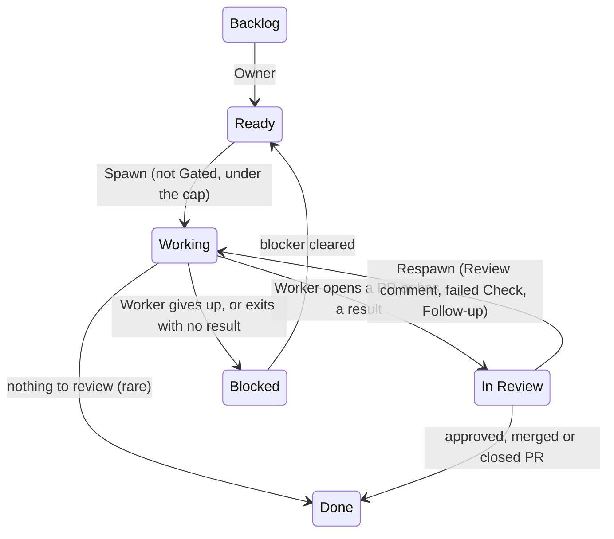

# Open Loops Specification

This file states what Open Loops does: the Task states, the Cycle, the five Slot Contracts and the invariants. Read it to write a notes file for your own tool, or before you change the core. The words are defined in [`GLOSSARY.md`](GLOSSARY.md).

The behavior lives in two prompts: [`core/orchestrator.md`](core/orchestrator.md) and [`core/worker-rules.md`](core/worker-rules.md). This file and those prompts must agree. A change to one is a change to both, in the same commit (see [`AGENTS.md`](AGENTS.md)).

## 1. Parts

| Part | Where | What it is |
|---|---|---|
| Orchestrator prompt | [`core/orchestrator.md`](core/orchestrator.md) | One Cycle. The Host starts it as a new agent session on a schedule. It names no Slot product. |
| Worker rules | [`core/worker-rules.md`](core/worker-rules.md) | What every Worker does, from its Spec to In Review or Blocked. |
| Exploration Worker agent | [`core/agents/auto-researcher.md`](core/agents/auto-researcher.md) | The agent that runs an Exploration Spec (`agent: auto-researcher`). |
| State schema | [`core/state.schema.json`](core/state.schema.json) | The schema of `state.json`. |
| Spec templates | [`core/templates/`](core/templates/) | The Build Spec and Exploration Spec templates. |
| Slot Contracts and examples | [`adapters/<slot>/`](adapters/README.md) | Each Slot's Contract (its `README.md`) and example notes files. |
| Setup | [`SETUP.md`](SETUP.md) | Instructions for the Owner's coding agent. |
| Optional modules | [`modules/`](modules/) | capture, refine, wiki (with wiki-gardener). The core never needs them. |

## 2. Home directory

The home directory (default `~/.openloops/`) persists between Cycles. It holds:

- `state.json`: the state file. It is the only truth between Cycles.
- `orchestrator.log`: the Cycle log, newest entry first, at most 500 entries.
- Five notes files, one for each Slot: `tracker.md`, `host.md`, `runtime.md`, `notifier.md`, `review.md`.

The Orchestrator reads all five notes files at the start of each Cycle, and uses only the tools they name for Slot work. Real values (IDs, paths, logins) are only in the home directory. The files in this repo hold `{{...}}` placeholders only.

## 3. Task states

A Task is in one of six states. `tracker.md` maps each one to the Tracker's native name.

| State | Meaning | Who moves a Task into it |
|---|---|---|
| Backlog | The Owner still shapes the Task and its Spec. The Orchestrator never reads, moves or comments on it. | The Owner only. |
| Ready | Defined well enough for a Worker to take with no human. | The Owner (or a refinement agent, with the Owner's yes). The Orchestrator, when a Blocked Task's blocker clears. |
| Working | The Task has a live Worker. | The Orchestrator, at Spawn or Respawn. |
| Blocked | The Worker stopped on a problem that only the Owner can clear. | The Worker. The Orchestrator verifies and corrects. |
| In Review | The result waits for the Owner or a reviewer. | The Worker. The Orchestrator verifies and corrects. |
| Done | Nothing more is needed from anyone. | The Orchestrator (approved, merged or closed PR). The Worker, only when its work left nothing to review (rare). The Owner, at any time. |

Two conditions are not states:

- **Gated**: a Ready Task with an upstream Task that is not Done. It stays in Ready and spawns by itself when the upstream Task is Done.
- **Input Request**: a live Worker paused on a permission or question prompt. Its Task stays Working.

The Owner can move any Task to any state, including back to Backlog. The Orchestrator never moves a Task to Backlog, and never moves a Task that is already Done.

## 4. The Cycle

A Cycle is one pass of the Orchestrator over the Tracker. The Host starts each Cycle as a new session. The steps, in order:

1. **Monitor live Workers.** List the `ol-` Workers with the Runtime and get each status: `working` (skip), `idle` (completion), `exited` (completion if the Worker left a result for the Owner in the Tracker or its state path, judged by the Orchestrator; else Blocked with "Worker exited without a result"), `Input Request` (answer it, or notify the Owner). On completion: send the gap-fill prompt once if the Spec has dependents, stop the Worker, verify the Task state in the Tracker, update `state.json`, notify.
2. **Read Ready Tasks.** Find the Ready Tasks. Only leaf Tasks spawn. Look for a pending Follow-up, find the Spec, and apply the dependency gate.
3. **Spawn Workers.** Most dependents first, up to the cap. Make or reuse the Workspace, make the state path, start the Worker with its first prompt, move the Task to Working, record it, notify.
4. **Cap check.** At the cap, spawn nothing more and log which Tasks wait.
5. **Monitor In Review.** For each Task: a pending Follow-up, a new Review comment or a failed Check gives a Respawn. An approved, merged or closed PR gives Done. A fulfilled Follow-up gives no action: the Task stays In Review until the PR state or the Owner moves it.
6. **Monitor Blocked.** If the blocker has cleared, move the Task back to Ready. Otherwise notify the Owner once.
7. **Log the Cycle** in `orchestrator.log`.

Step 1 comes before step 2, so that a completion in this Cycle clears a dependency gate in the same Cycle.

## 5. Specs

- Each Task points to exactly one Spec: a **Build Spec** (has `## Acceptance Criteria`) or an **Exploration Spec** (has `## Hypothesis`, a success metric and a time budget).
- **Spec location:** a `Spec:` line in the Task names a Spec file (in the project repo or in a wiki). With no `Spec:` line, the Task body is the Spec.
- **Spawn fields:** `workspace`, `branch`, `depends_on` and `agent` are frontmatter in a Spec file, or a front block at the top of the Task body.
- The templates also have `tracker_id`, `report` (a local Markdown or HTML path for an Exploration Spec's findings) and `spec_status` (`deferred` is never spawned).
- The slug comes from the Spec file name (`paper-plan.md` gives `paper-plan`), or from the Task name when the Task body is the Spec. The Worker name is `ol-<slug>`.

## 6. Workspaces and Worker state

- **Worktree mode** (the Spec has a `branch:` and the target is a git repo): the Workspace is a git worktree at `<repo>/.openloops/worktrees/<slug>`, on a new branch `ol-<slug>` forked from `branch`. A Runtime that makes worktrees itself (Herdr) says so in `runtime.md`.
- **Directory mode** (no `branch:`, or not a git repo): the Workspace is the directory itself.
- Workspaces are durable. They are reused on every Respawn and never deleted or force-overwritten by Open Loops.
- The Worker's state path is `<repo>/.openloops/<slug>/`, outside the worktree, and `.openloops/` is gitignored. It holds `implementation-notes.html` (every Spec), `experiments-comparator.html` (when the Worker compares variants), and the Exploration files (`results.tsv` and the findings report).

## 7. The Worker

- It reads `tracker.md` and `review.md`, then its Spec, then works in a Closed Loop until the goal is met or it is truly blocked.
- **Completion steps:** commit → the project's build and test command → the review skill that `review.md` names (default `code-review` from mattpocock/skills) → publish (only as `review.md` says: a push, an upload, or nothing) → open the PR (draft or ready, per `review.md`) → verify → a Tracker comment with the PR reference → move the Task to In Review → update the Spec's Status checklist.
- On Review comments: a Review round. The fix is new commits on the same branch, or an amended commit, as the `Review rounds` line of `review.md` says, then a reply to each Review comment.
- If blocked: a Tracker comment with the reason, then move the Task to Blocked.
- It writes the Tracker itself (comments, state). The Orchestrator verifies and corrects.
- It never merges and never exits by itself. The Orchestrator stops it.

## 8. Slot Contracts

Each Slot's `adapters/<slot>/README.md` holds the same Contract, a Contract map for each example notes file, and the examples. A tool with no example is fine: write its notes file against the Contract, one item at a time.

### Tracker

The Tracker stores Tasks and their states. A Tracker must let the Orchestrator and the Worker:

- [ ] Find the Tasks in a state.
- [ ] Read a Task's body.
- [ ] Read a Task's comments, each with an id.
- [ ] Read a Task's children.
- [ ] Read a Task's dependencies (and its dependents).
- [ ] Post a comment on a Task.
- [ ] Change a Task's state.

`tracker.md` holds the tools for each capability, the map from the six states to the native names, the IDs, the Follow-up prefix (default `ACTION:`), and the quirks of the tool. Rules for every Tracker: the Spec location and spawn fields of section 5; only leaf Tasks spawn; a dependency is resolved only when the upstream Task is Done (`tracker.md` says if a closed Task counts as Done); whether a Follow-up is fulfilled is the Orchestrator's judgment. Examples: [GitHub Issues](adapters/tracker/github-issues.md) (default), [Markdown files](adapters/tracker/markdown.md) (fallback).

### Host

The Host starts the Orchestrator on a schedule. A Host must:

- [ ] Start the Orchestrator prompt as a new unattended agent session on a schedule (one session per Cycle).
- [ ] Keep a home directory that persists between Cycles.
- [ ] Give the Orchestrator the Owner's tools for the other Slots, plus a shell.
- [ ] Run with no permission prompts (auto or bypass permission mode).

`host.md` fields:

- [ ] Host name
- [ ] How a Cycle starts (the exact command)
- [ ] Interval (default 30 minutes)
- [ ] Home directory (default `~/.openloops/`)
- [ ] Model and effort of the Orchestrator
- [ ] Permission mode
- [ ] How to stop and remove

The Host, the Runtime and the Workspaces are on one machine. Crontab examples wrap the command in `timeout <interval minus 5 minutes>`. With the wiki module, the Host runs wiki-gardener as a second scheduled job with the same capabilities. Examples: [cron + `claude -p`](adapters/host/cron-claude.md) (default), [cron + `codex exec`](adapters/host/cron-codex.md), [KiroCrew](adapters/host/kirocrew.md), [OpenClaw](adapters/host/openclaw.md).

### Runtime

The Runtime spawns, watches and stops Workers. A Runtime must supply all five:

- [ ] Spawn a named Worker, with an agent, a model, a directory and a first prompt.
- [ ] List the Workers, each with its status.
- [ ] Read a Worker's recent output.
- [ ] Send text or keys to a live Worker.
- [ ] Stop a Worker.

`runtime.md` also says:

- [ ] How to get each core status: `working`, `idle`, `Input Request`, `exited`.
- [ ] The agent start command, model flags and extras (the Build Spec prefix, the option that starts the Exploration Worker agent for an Exploration Spec).
- [ ] The keys that answer an Input Request (one-shot approve, deny) and the keys never to send.
- [ ] The Runtime ids to store in `state.json`.
- [ ] Whether the Runtime makes worktrees itself. If not, the core makes each Workspace as a plain git worktree at `<repo>/.openloops/worktrees/<slug>`.
- [ ] The cap on live Workers (default 5).

Rules for every Runtime: Worker names are `ol-<slug>`; a Workspace is never force-overwritten; Workers run in auto or bypass permission mode. Examples: [Herdr](adapters/runtime/herdr.md) (recommended), [tmux](adapters/runtime/tmux.md) (fallback), each with Claude Code or Codex.

### Notifier

The Notifier delivers messages to the Owner. A Notifier must:

- [ ] Send one text message to the Owner.

Events: `spawned`, `respawned` (with its trigger: comments, failed check, both, or follow-up), `input_requested`, `blocked`, `in_review`, `done`, `unblocked`, `system_alert`, `system_recovered`. With the wiki module, wiki-gardener also sends `wiki_gardener`. There is one Notifier. It only sends, and never reads replies. Messages give file paths, with no link base. Example: [log file](adapters/notifier/log-file.md) (default). The Host's own messaging (KiroCrew, OpenClaw) or a messaging MCP server can fill the Slot (see [`adapters/notifier/README.md`](adapters/notifier/README.md)).

### Review System

The Review System holds PRs, Review comments and Checks.

The Worker must be able to:

- [ ] Publish a branch (push it, upload it with a review tool, or nothing).
- [ ] Open a PR (as a draft or as ready, per `review.md`).
- [ ] Publish more commits to the PR.
- [ ] Reply to a Review comment.

The Orchestrator must be able to:

- [ ] Read a PR's state: open, approved, merged, closed.
- [ ] Read a PR's Review comments, each with an id.
- [ ] Read a PR's Checks.

`review.md` also says:

- [ ] `Open PRs as: draft | ready` (default: draft).
- [ ] The remote to push to, if the Review System pushes.
- [ ] `Review rounds: new commits | amend` (default: new commits).
- [ ] The form of a PR reference in Tracker comments.
- [ ] The review skill the Worker runs before it opens the PR (default: `code-review` from mattpocock/skills).
- [ ] The build and test command of each project.

Triggers: a new Review comment or a failed Check → Respawn; approved or merged → Done; closed without merge → Done. Setup makes no repo settings or rulesets. Examples: [GitHub PR](adapters/review/github-pr.md) (default), [Local branch](adapters/review/local-branch.md) (fallback). In the Local branch Review System, the PR is the Task branch, Review comments are Tracker comments with the Follow-up prefix, the Checks are the build and test command that the Worker runs, and Done is a merge of the branch into `main` or the Owner's move to Done.

## 9. State file

`<home>/state.json` matches [`core/state.schema.json`](core/state.schema.json). Top-level keys:

- `ol-<slug>`: one record for each Task that has or had a Worker and is not yet Done: `task_id`, `spec`, `workspace`, `runtime_ids` (only while the Worker is live), `started`, `status` (`working`, `in_review` or `blocked`), and the optional `review_state.last_comment_id`, `pending_prompt`, `gap_fill_done` and `blocked_notified`.
- `chain_stalled_notified`: Gated Task id → id of its Blocked upstream Task.
- `alerts`: one entry for each Slot whose tools fail, with `since` and `message`. The key is the lowercase name of the Slot's notes file: `tracker`, `host`, `runtime`, `notifier` or `review`.

## 10. Notifications

- **Silent mode:** no message when nothing happened, and never the same message twice for the same event.
- The dedup keys are in `state.json`: `pending_prompt`, `blocked_notified`, `chain_stalled_notified`, `review_state.last_comment_id` and `alerts`.
- A send failure is logged in `orchestrator.log` and never stops the Cycle.

## 11. Invariants

1. The Orchestrator never does Task work. It never reads a Spec for work, and it uses no subagents.
2. `state.json` is the only truth between Cycles. A Cycle never relies on memory of an earlier one.
3. The Orchestrator never reads, moves or comments on a Backlog Task, and never moves a Task to Backlog.
4. Only leaf Tasks spawn. A parent Task never gets a Worker.
5. A dependency is resolved only when the upstream Task is Done. In Review and Blocked do not count.
6. At most one live Worker for each Task, and at most the cap of live `ol-` Workers in total (default 5).
7. A Workspace is never deleted or force-overwritten by Open Loops. A Respawn reuses it.
8. No agent merges. The Worker never runs a merge command; the Owner merges.
9. A Worker publishes only with the capabilities that `review.md` names. It never pushes or uploads in another way. The Orchestrator approves a push or upload that `review.md` names, and denies any other.
10. A Worker never exits by itself. The Orchestrator stops it.
11. A comment-triggered Respawn happens once for each new Review comment id. A failed Check is limited only by the live-Worker guard.
12. A Slot tool failure (Tracker, Runtime, Review System, or a missing notes file) sends one `system_alert`, stops the Cycle with no other state change, and is logged. Recovery sends `system_recovered`. A Notifier failure never stops the Cycle.
13. The Orchestrator prompt names no Slot product and never states the Cycle interval. Products and intervals live only in the notes files.
14. The Orchestrator runs only shell commands that never wait for input.
15. Every Cycle adds one entry to `orchestrator.log`.

## 12. Tests

The Cycle fixture in [`tests/cycle_fixture/`](tests/cycle_fixture/README.md) runs real Cycles in a sandbox with the local fallbacks and checks only external results: Task files, `state.json`, git branches, the Cycle log and the Notifier log. Its offline checks also verify that each Slot Contract in this file is the same as in `adapters/<slot>/README.md`.
